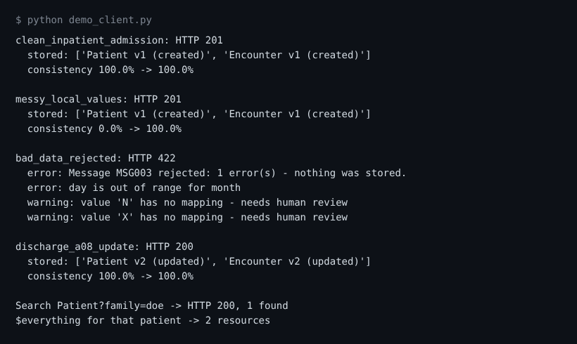

# FHIR Gateway: HL7 v2 to FHIR R4

A small REST API that receives **HL7 v2 ADT admission messages**, checks and normalizes them,
converts them to **FHIR R4 Patient and Encounter** resources, and stores them with
**version history** and a **data-quality audit trail**.

> Learning project, rebuilt from a larger integration idea. All data is fake. It follows a *draft* HL7 v2-to-FHIR guide and has not been
> validated or secured for real patient data.



## Why it exists

Interfaces fail quietly when coded values disagree ("F" vs "Female") or dates are impossible.
This gateway makes those problems visible: every message gets a **semantic consistency score**
(before and after normalization), and unsafe messages are **rejected with a FHIR OperationOutcome**
instead of being half-converted.

## What it does

- Parses HL7 v2 (repeating fields, components, escape sequences)
- Maps `PID -> Patient` and `PV1 -> Encounter` following the
  [HL7 v2-to-FHIR IG](https://build.fhir.org/ig/HL7/v2-to-fhir/) rules (birth time extension,
  administrative sex and patient class vocabulary maps, discharge-driven encounter status)
- Normalizes local spellings through lookup tables; flags codes with no safe mapping for human review
- Validates real calendar dates (31 Feb is rejected)
- Stores each resource with `meta.versionId`; re-sending an identical message creates no new version,
  an A08 update creates version 2
- FHIR-style API: read, search, `_history`, `$everything`, `metadata` (CapabilityStatement)
- Audit log and `/stats` dashboard numbers (consistency before/after, rejection rate, top issues)
- Interactive Swagger docs at `/docs`

## Run it (Windows)

1. Double-click **run_server.bat** (creates a virtual environment, installs Flask, starts the server)
2. Your browser opens **http://127.0.0.1:5000/docs**, open `POST /hl7`, click *Try it out*, then *Execute*
3. In a second window run `python demo_client.py` to send the four sample messages

Tests: `python -m unittest test_api -v` (and `python hl7_to_fhir.py test` for the converter)

## Example

```
POST /hl7
PID|1||20001^^^DEMO_HOSP^MR||Khan^Sara^^^^^L||19950412|Female
PV1|1|Inpatient|Ward 5^Room 12^Bed 1|...

201 Created
"consistencyBeforePct": 0.0, "consistencyAfterPct": 100.0
Patient v1 (created), Encounter v1 (created)
```

## Files

| File | Purpose |
|---|---|
| `hl7_to_fhir.py` | parser, mapping rules, lookup tables, quality scoring |
| `api_server.py` | Flask API, SQLite storage, versioning, search, OpenAPI docs |
| `test_api.py` | API tests (ingest, rejection, versioning, search, stats) |
| `demo_client.py` | sends sample messages and prints results |

## Known limits / next steps

ADT A01/A04/A08 only (no ORU lab results yet), Patient and Encounter only, no authentication,
search is simple (loads current resources in memory), SQLite for a single user.
Next: ORU to Observation, terminology service (LOINC / SNOMED), FHIR validator in CI.
